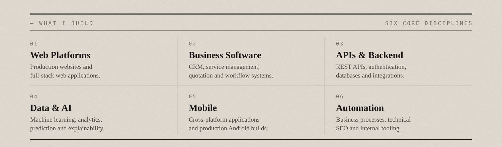
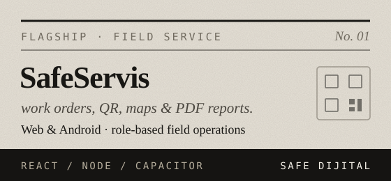
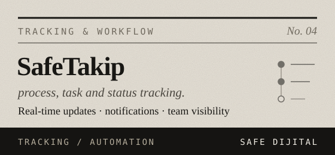
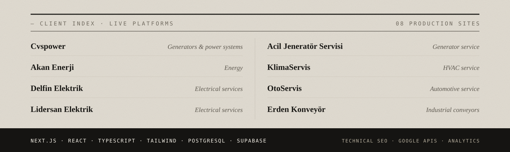
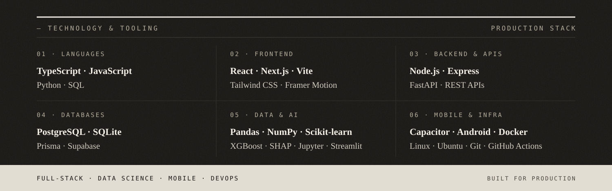
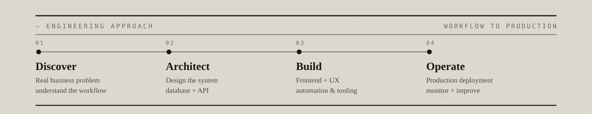

  

  
  
  
  
  

I build software around real business problems: taking a real-world workflow, understanding how it actually works, designing the system behind it and turning it into software that runs in production.

My work spans **full-stack web apps, business management systems, APIs, automation** and **data / machine learning**.

---

## What I Build

  

---

## Featured Projects

### SafeServis

A field-service and operations management platform built under [Safe Dijital](https://safedijital.com) for service-based businesses.

- **Operations:** customers, service / work orders, reporting, PDF documents, QR tracking, maps & locations
- **Platform:** authentication & role-based access, web + Android (Capacitor)
- **Stack:** `React` · `TypeScript` · `Node.js` · `Express` · `PostgreSQL` / `SQLite` · `Capacitor`

### Safe Dijital Products

Modular business software under [Safe Dijital](https://safedijital.com): common service-industry workflows turned into products that can be adapted to different companies.

<table>
  <tr>
    <td width="50%"></td>
    <td width="50%"></td>
  </tr>
  <tr>
    <td width="50%"></td>
    <td width="50%"></td>
  </tr>
</table>

- **SafeServis** — field service, work orders, QR tracking, maps, PDF reports · web & Android
- **SafeTeklif** — quotation management, PDF generation, online customer approval
- **SafeFatura** — invoice and reporting workflows · `React` · `FastAPI`
- **SafeTakip** — process, task and status tracking, notifications and team visibility
- **SafeApartman** — apartment & building management: residents, dues, expenses, maintenance requests · `React` · `Vite` · `Node.js` · `Express` · `Prisma`

> Live demos and product walkthroughs are available at **[safedijital.com](https://safedijital.com)**.

### [Customer Churn Prediction](https://github.com/BaranAsln0734/churn-prediction)

An end-to-end machine learning project, from raw data to an API and dashboard.

`Data → EDA → Feature Engineering → SMOTE → Model Training → SHAP → FastAPI → Streamlit`

Includes multiple model comparison, SHAP explainability, business impact analysis, automated tests and Docker support.
**Stack:** `Python` · `Pandas` · `Scikit-learn` · `XGBoost` · `SHAP` · `FastAPI` · `Streamlit`

### Client Web Platforms

Production websites and digital platforms for real businesses, live and maintained.

  

---

## Technology

  

---

## Engineering Approach

  

  

