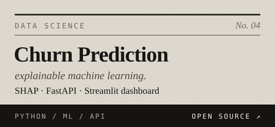
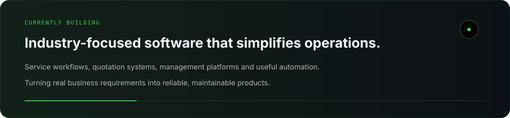
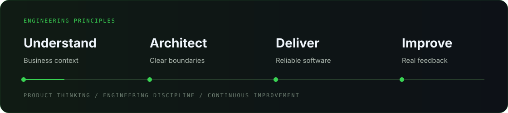

  
  
  

  

  
   <strong>SAFE DIJITAL</strong> Custom Software · Vertical SaaS · Business Automation

---

## About

I'm a software developer focused on building practical digital products for real business operations. Through **Safe Dijital**, I work on business software, sector-specific SaaS products, web platforms and automation systems.

My work connects product thinking with engineering: understanding the workflow, modelling the data, building the API and interface, and delivering something people can use.

- **Software engineering:** Full-stack applications, ERP-style systems, REST APIs and SaaS products.
- **Data & AI:** Machine learning, explainable models, analytics and intelligent workflows.
- **Product focus:** Service operations, quotation processes, reporting and industry-specific platforms.

## Selected work

  
  

  
  

<a href="https://safedijital.com"><strong>Explore Safe Dijital →</strong></a> &nbsp;·&nbsp; <a href="https://github.com/BaranAsln0734?tab=repositories">All repositories →</a>

## What I'm building

## Engineering principles

## GitHub activity

  
  

## Technology

Pandas · NumPy · Scikit-learn · XGBoost · SHAP · Streamlit · REST APIs

<strong>Building useful software with Safe Dijital.</strong> <a href="https://safedijital.com">safedijital.com</a>

Animated SVG layout adapted from <a href="https://github.com/saroo98/profile-signal-kit">Profile Signal Kit</a> (MIT License). See <a href="./THIRD_PARTY_NOTICES.md">third-party notices</a>.
