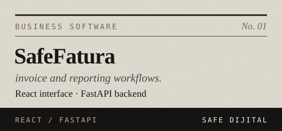
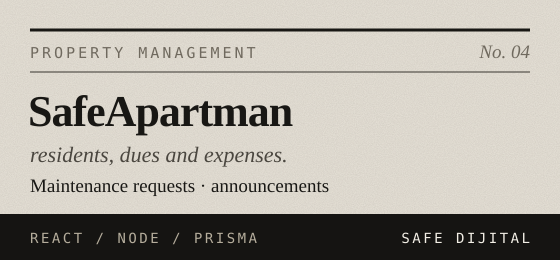

<p align="center">
  
</p>

<p align="center">
  <a href="https://github.com/BaranAsln0734">
    
  </a>
  <a href="https://www.linkedin.com/in/veli-baran-aslan-7a0b21301">
    
  </a>
  <a href="https://safedijital.com">
    
  </a>
</p>

I build software around real business problems: taking a real-world workflow, understanding how it actually works, designing the system behind it and turning it into software that runs in production.

My work spans **full-stack web apps, business management systems, APIs, automation** and **data / machine learning**.

---

## What I Build

| Area | Focus |
|---|---|
| Web Platforms | Production websites and web applications |
| Business Software | CRM, service management, quotation and workflow systems |
| APIs & Backend | REST APIs, authentication, databases and integrations |
| Data & AI | Machine learning, analytics, prediction and explainability |
| Mobile | Cross-platform apps and Android builds |
| Automation | Business processes, SEO automation and internal tooling |

---

## Featured Projects

### Cvspower

A generator sales & service management platform built around a real operational workflow.

- **Operations:** customers, service / work orders, reporting, PDF documents, QR tracking, maps & locations
- **Platform:** authentication & role-based access, web + Android (Capacitor)
- **Stack:** `React` · `TypeScript` · `Node.js` · `Express` · `PostgreSQL` / `SQLite` · `Capacitor`

### Safe Dijital Products

Modular business software under [Safe Dijital](https://safedijital.com): common service-industry workflows turned into products that can be adapted to different companies.

<table>
  <tr>
    <td width="50%"></td>
    <td width="50%"></td>
  </tr>
  <tr>
    <td width="50%"></td>
    <td width="50%"><a href="https://github.com/BaranAsln0734/churn-prediction"></a></td>
  </tr>
</table>

- **SafeFatura** — invoice and reporting workflows · `React` · `FastAPI`
- **SafeTeklif** — quotation management, PDF generation, online customer approval
- **SafeServis** — service tracking, work orders, employee workflows and notifications
- **SafeApartman** — residents, dues, expenses, maintenance requests · `React` · `Vite` · `Node.js` · `Express` · `Prisma`

### [Customer Churn Prediction](https://github.com/BaranAsln0734/churn-prediction)

An end-to-end machine learning project, from raw data to an API and dashboard.

`Data → EDA → Feature Engineering → SMOTE → Model Training → SHAP → FastAPI → Streamlit`

Includes multiple model comparison, SHAP explainability, business impact analysis, automated tests and Docker support.
**Stack:** `Python` · `Pandas` · `Scikit-learn` · `XGBoost` · `SHAP` · `FastAPI` · `Streamlit`

### Client Web Platforms

Production websites and digital platforms for real businesses, live and maintained.

| Project | Industry |
|---|---|
| **Cvspower** | Generators & power systems |
| **Akan Enerji** | Energy |
| **Delfin Elektrik** | Electrical services |
| **Lidersan Elektrik** | Electrical services |
| **Acil Jeneratör Servisi** | Generator service |
| **KlimaServis** | HVAC service |
| **OtoServis** | Automotive service |
| **Erden Konveyör** | Industrial conveyors |

**Stack:** `Next.js` · `React` · `TypeScript` · `Tailwind CSS` · `PostgreSQL` · `Supabase`
**Also:** technical SEO, indexing automation with Google APIs, performance, analytics and production deployment.

---

## Technology

<p>
  
</p>
<p>
  
</p>

Plus `Pandas` · `NumPy` · `XGBoost` · `Jupyter` · `Streamlit` · `Capacitor` · `Framer Motion`

---

## Engineering Approach

```text
Real Business Problem → Understand the Workflow → Design the System
→ Database + API → Frontend + UX → Automation → Deployment → Monitor + Improve
```

<p align="center">
  <a href="https://safedijital.com"></a>
</p>
